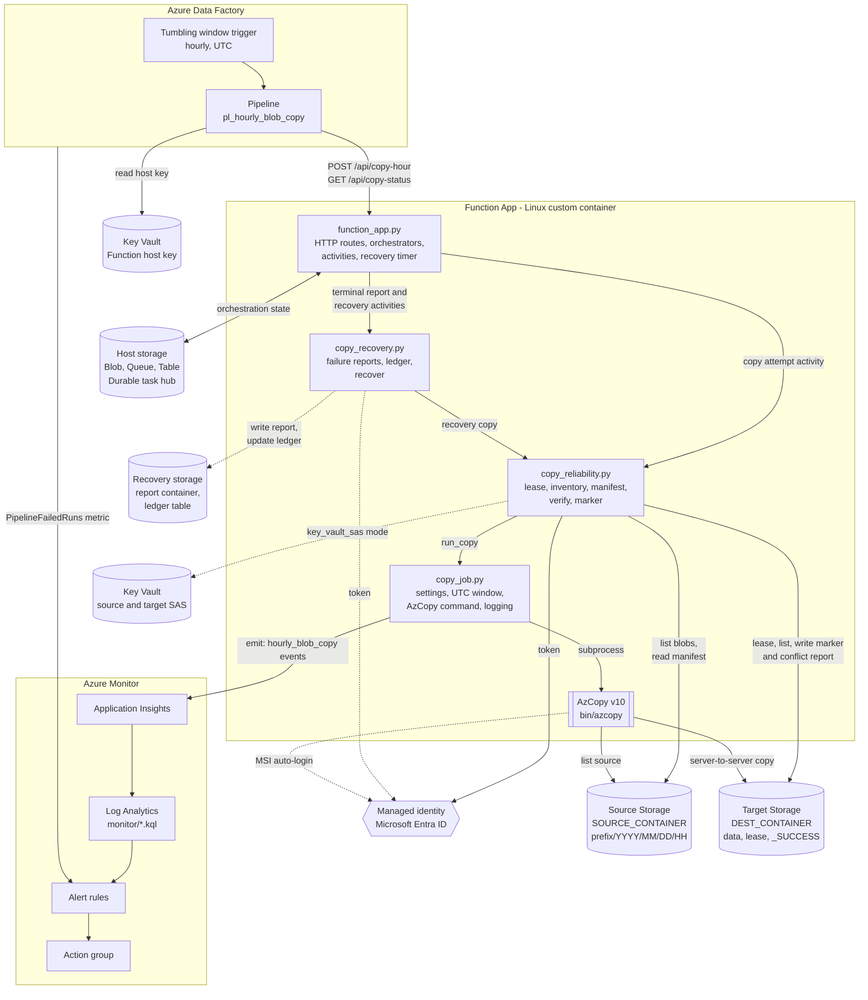

# Hourly Azure Blob copy with AzCopy — v4

**v4 adds an optional [Private Link deployment profile](infra/private-link/README.md)** for ADF, Functions, Storage, Key Vault, the container registry, and Azure Monitor. It does not change the v3 copy, verification, retry, or recovery behavior. Use the standard settings below or follow the private profile before restricting public access.

**ADF tumbling window → HTTP starter → Durable activity runs AzCopy → ADF polls status.** The HTTP requests are short; the transfer can take longer than Azure Functions' [230-second HTTP response limit](https://learn.microsoft.com/en-us/azure/data-factory/control-flow-azure-function-activity#timeout-and-long-running-functions). The pipeline succeeds only after a completed copy, an allowed empty window, or successful verification/reconciliation. Turn on strict manifest mode when downstream systems need a positive completeness signal.

## At a glance

| If you need to… | Start here |
|---|---|
| See how the Python files connect to Azure services | [How the pieces connect](#how-the-pieces-connect) |
| Configure storage accounts, identities, or the hour-folder convention | [1. Configure the Function App](#1-configure-the-function-app) |
| Install the AzCopy binary and publish the container image | [2. Build and deploy the Python project](#2-build-and-deploy-the-python-project) |
| Set up the ADF pipeline and hourly trigger | [3. Configure Azure Data Factory](#3-configure-azure-data-factory) |
| Set up failure reports or recover a failed hour | [4. Enable durable recovery (optional)](#4-enable-durable-recovery-optional) |
| Find monitoring queries and alert settings | [5. Monitor and alert](#5-monitor-and-alert) |
| Check the staging requirements before turning on the trigger | [6. Validate before activation](#6-validate-before-activation) |
| Deploy without public workload endpoints | [Private Link deployment profile](infra/private-link/README.md) |

## Supported environment

This project targets **Azure Blob Storage in Azure public cloud**, Linux x64, Azure Functions v4, and Python 3.12. It uses Blob endpoints, not Azure Files shares, and does not preserve ADLS Gen2 ACLs, tags, versions, or snapshots. Deploy the same image to separate Function Apps for separate source/target pairs. App settings, not callers, select storage accounts and credentials.

> **Upgrade and cutover:** For an upgrade, pause the ADF triggers and let existing transfers finish before changing the deployed image or linked services. V1 runs do not honor the destination-hour lease. Deploy the image and updated ADF pipeline together, run the staging checks, then resume scheduling. V3 does not import old failed runs; rerun an earlier failed UTC hour with `mode=reconcile` as needed.

---

## How the pieces connect

The diagram shows which Python file talks to which Azure service at run time. Solid arrows are the default managed-identity path. Dashed arrows apply only with certain settings: SAS copy mode (`COPY_AUTH_MODE=key_vault_sas`) or durable recovery (`COPY_RECOVERY_STORAGE_ACCOUNT`). On the storage arrows, the manifest read and `_SUCCESS` marker apply only in strict manifest mode (`COPY_REQUIRE_MANIFEST=true`), and the conflict report only when `COPY_WRITE_CONFLICT_REPORT=true`.



| Python file | Azure services it uses | What it does there |
|---|---|---|
| `function_app.py` | Data Factory (caller), host storage | Receives the ADF start and status calls, keeps Durable orchestration state in the task hub, and runs the optional recovery timer. It calls no storage SDK directly. |
| `copy_reliability.py` | Source and target Blob, Microsoft Entra ID, optional Key Vault | Gets a token with the managed identity (and SAS secrets in `key_vault_sas` mode), lists and reads the source hour, holds the target-hour lease, verifies results, and writes the `_SUCCESS` marker and optional conflict report. |
| `copy_job.py` | AzCopy, Application Insights | Builds and runs the AzCopy command (MSI auto-login or SAS) and writes every structured `hourly_blob_copy` log line that the KQL queries and alerts read. |
| `copy_recovery.py` | Recovery Blob and Table, Microsoft Entra ID | Writes private failure reports, tracks failed hours in the ledger table, and reruns retryable hours through `copy_reliability.py`. |

> **Not in the diagram:** Azure Container Registry supplies the container image at deployment and startup, not at run time. For the Private Link version of these paths, see the [Private Link deployment profile](infra/private-link/README.md).

---

## 1. Configure the Function App

### Required storage and path settings

Use [`app-settings.example.json`](app-settings.example.json) as a list of app setting names and string values. Replace the examples. The four account/container settings are required. Create both containers first; the code is not a container provisioner.

| Setting | Value or default |
|---|---|
| `SOURCE_STORAGE_ACCOUNT`, `SOURCE_CONTAINER` | Source account and Blob container names (not URLs). |
| `DEST_STORAGE_ACCOUNT`, `DEST_CONTAINER` | Target account and Blob container names. A source/target pair cannot reuse the same container in the same account. |
| `SOURCE_PREFIX` | Empty or omitted for the container root; `Level1/Level2/Level3` for nested files. Backslashes are accepted in the setting and normalized to `/`. The prefix is a literal, case-sensitive path, not a wildcard or a discovery rule. |
| `DEST_PREFIX` | Omit to mirror `SOURCE_PREFIX`; explicitly set an empty string to write under the destination container root. Otherwise set the desired target prefix. The date/hour and relative file paths are always appended. |

### Transfer and authentication settings

| Setting | Value or default |
|---|---|
| `COPY_AUTH_MODE`, `COPY_MI_CLIENT_ID` | `managed_identity` by default. Leave the client ID unset for system-assigned identity; set the client ID for an attached user-assigned identity used by the data-copy worker. |
| `COPY_KEY_VAULT_URL`, `COPY_SOURCE_SAS_SECRET`, `COPY_DEST_SAS_SECRET` | Used only when `COPY_AUTH_MODE=key_vault_sas`; see below. |
| `COPY_ALLOW_EMPTY` | `true` allows an empty ordinary copy (`NoData`) or an explicit empty manifest (`Verified`). `false` fails those primary runs without retrying an intentionally empty window. A missing manifest or failed listing is never treated as empty. Non-manifest reconciliation reports how many source objects it observed, even if zero. |
| `COPY_OVERWRITE` | `false` (default) skips existing target blobs by name, without comparing contents. Set `ifSourceNewer` or `true` only for ordinary unverified copies and only if replacement is intended. Strict verification and reconciliation **always** use no-overwrite. No data blobs are deleted. |
| `COPY_PRESERVE_ACCESS_TIER` | `false` by default; enable only if the target supports the source tier. |
| `AZCOPY_PATH`, `AZCOPY_TIMEOUT_SECONDS` | `/usr/local/bin/azcopy`, `2700` (45 min); valid subprocess limit is 1–3300 seconds. The worker uses a 56-minute shared budget; `host.json` caps the activity at 58 minutes. Leave room for verification and storage/Key Vault calls. The sample ADF polling allowance is 3 hours 30 minutes for up to three activity attempts. |

### Verification and retry settings

| Setting | Value or default |
|---|---|
| `COPY_REQUIRE_MANIFEST` | `false` by default; set `true` after the producer implements the manifest contract below. Only strict mode writes a destination verification marker. |
| `COPY_MANIFEST_NAME`, `COPY_SUCCESS_MARKER_NAME` | `_MANIFEST.json`, `_SUCCESS`. These hourly root names are reserved control files; the worker doesn’t copy them as data. Keep the names stable for a feed. |
| `COPY_MAX_WINDOW_FILES` | `10000`. Bound each manifest or inventory in strict/reconciliation mode. A manifest is also limited to 4 MiB. Exceeding a limit fails safely rather than copying an incomplete list. |
| `COPY_WRITE_CONFLICT_REPORT` | `false`; with `true`, write a create-only JSON report under the target control prefix with up to 1,000 conflicting blob names and sizes. Enable only if target readers may see these names. Without it, Azure Monitor still records window and conflict counts. |
| `COPY_RETRY_COUNT`, `COPY_RETRY_BASE_SECONDS` | `2` (0–2 additional attempts); base `30` seconds (1–300). Durable waits 30, then 60 seconds by default for classified failures. Retry policy is captured when the run starts. After a failure, v3 uses a fresh inventory and no-overwrite copy for subsequent attempts. An unexpectedly empty non-manifest source after failure is not treated as recovery success. |

### Runtime and monitoring settings

| Setting | Value or default |
|---|---|
| `AZCOPY_CONCURRENCY_VALUE`, `AZCOPY_BUFFER_GB` | Optional AzCopy tuning knobs. Change only after checking instance capacity and throughput. |
| `COPY_TASK_HUB` | Distinct per Function App and slot sharing host storage: 3–45 letters/digits, beginning with a letter. Do not rename while runs are active. |
| `AzureWebJobsStorage__accountName` | Name of a separate general-purpose storage account supporting Blob, Queue and Table for the Functions host and Durable state. If switching from a connection string, remove the exact `AzureWebJobsStorage` setting after configuring and testing identity-based host storage in a test app. |
| `FUNCTIONS_WORKER_RUNTIME` | `python`. |
| `APPLICATIONINSIGHTS_CONNECTION_STRING` | Connection string of the workspace-based Application Insights resource. No monitoring SDK or ingestion endpoint is needed in the code. |
| `APPLICATIONINSIGHTS_AUTHENTICATION_STRING` | Optional for Entra ingestion: `Authorization=AAD` (system-assigned) or `ClientId=<client-id>;Authorization=AAD` (user-assigned). Keep the connection string and assign the identity **Monitoring Metrics Publisher** on Application Insights. |

### UTC folder example

`windowStart=2026-11-18T14:00:00Z`, `windowEnd=2026-11-18T15:00:00Z`

The function copies `Level1/Level2/Level3/2026/11/18/14/subdir/data.csv` to the same relative path in the destination, unless `DEST_PREFIX` is set.

With a root source the path is `2026/11/18/14/subdir/data.csv`. `14` comes from the **start** of the window, not the trigger's fire time, current server time, or blob modification time. This also works for midnight (`00`) and backfills.

> **Time zone:** The project assumes UTC-named folders; local-time folders using daylight saving need a separate convention for the repeated fall-back hour.

### Identity, Key Vault, and networking

> **Private deployment:** For deployment with public data-plane access disabled, follow the [Private Link profile](infra/private-link/README.md), including the same-VNet storage topology and acceptance checklist.

- **Host storage:** Enable the Function App's system-assigned identity. For identity-based **host/Durable state** storage, assign it **Storage Blob Data Owner** (also covers the Functions host's Blob requirement), **Storage Queue Data Contributor**, and **Storage Table Data Contributor** on the dedicated host storage account. These are separate from the roles on copy data.
- **Default copy mode:** give the copy worker identity **Storage Blob Data Reader** on the source container and **Storage Blob Data Contributor** on the target container. When both endpoints use Entra, the storage accounts must be in the same Entra tenant; they can be in different subscriptions. AzCopy uses MSI auto-login; Python uses the same managed identity for the preflight source listing. No storage keys or SAS are needed.
- **Optional SAS copy mode:** apply `app-settings.key-vault-sas.example.json`; grant the worker identity **Key Vault Secrets User** on the relevant vault or secrets. Store two short-lived, HTTPS-only container SAS query strings (not full URLs), scoped to each container. Give source read/list (`rl`) and target read/create/write/list (`rcwl`), without delete. Use user-delegation SAS where supported. The Function fetches the current versions for each attempt; size validity to cover expected transfer duration and rotate before expiry. The same target identity or SAS creates and leases a tiny control blob, and in strict mode creates the verification marker. Confirm scope permits all those actions and that the container is not under a policy that blocks blob leases. SAS values aren't logged or put in Durable input/results, but AzCopy requires SAS on its child-process command line. Prefer managed identity, and don't use SAS mode where privileged process inspection or command-line collection is not acceptable.
- **ADF caller identity is separate.** The included linked services use the ADF identity to read a Key Vault secret holding a dedicated **host-level key** for this Function App. The two HTTP routes require Functions `FUNCTION` authorization. Use a host key for both routes, not the `_master` admin key. No key is stored in the ADF JSON. For deployments requiring Entra at the front door as well, configure App Service Authentication and [allow-list the ADF managed identity](https://learn.microsoft.com/en-us/azure/data-factory/control-flow-azure-function-activity#system-assigned-managed-identity-authentication); use the Function app registration's application ID as the linked service resource ID, not `https://management.azure.com`. Confirm both the Entra policy and Function-key checks in staging.
- **Network paths:** Validate private DNS, firewalls and routing from ADF's integration runtime to the Function App; from the Function App to copy storage, host storage, and (if used) Key Vault; and the [supported storage-to-storage topology](https://learn.microsoft.com/en-us/azure/storage/common/storage-use-azcopy-blobs-copy#guidelines) for the server-side copy itself.

> **AzCopy staging check:** VNet reachability from the Function App alone does not prove the storage-to-storage path will work.

---

## 2. Build and deploy the Python project

### Hosting and AzCopy prerequisites

Use a **Linux Premium** Function App with a custom container, or a **Linux Dedicated** plan with Always On. These support custom images and the sample activity timeout. Follow [Azure Functions custom container deployment](https://learn.microsoft.com/en-us/azure/azure-functions/functions-how-to-custom-container) for your registry and hosting setup.

The Dockerfile expects the official **AzCopy v10 Linux x64** executable at `bin/azcopy`. Obtain it from the [official release channel](https://github.com/Azure/azure-storage-azcopy/releases), verify it according to your supply-chain policy, and pin the version you smoke test. The archive does not contain a binary or credentials. For repeatable production builds pin the Functions base image digest and lock Python dependencies through your approved pipeline.

### Build and test

```bash
# Run these examples yourself against your own prepared environment.
# First place the approved executable at bin/azcopy.
docker build --platform linux/amd64 -t hourly-blob-copy:4 .
python -m unittest discover -s tests -v
```

### Deploy the image

Push the image to your approved container registry and configure the Function App to use it, preferably with managed identity for the registry pull. Apply the app settings and role assignments above.

> **Credential safety:** Do not place SAS tokens, Function keys or connection strings in the Docker build context or repository.

---

## 3. Configure Azure Data Factory

Apply the definitions under `adf/` using your normal ADF Git/CI flow or create equivalent objects in ADF Studio. These are individual resource documents (`name` + `properties`), not an ARM deployment template.

### Import order

1. **`ls_hourly_key_vault.json`**: set `baseUrl` and grant the ADF managed identity permission to read `hourly-copy-adf-host-key` (or the secret name you choose). Keep this invocation secret separate from storage SAS permissions.
2. **`ls_hourly_copy_function.json`**: set `functionAppUrl` to the Function App hostname without `/api`. Point `functionKey` to the Key Vault secret. If configuring in Studio, select Key Vault for the key and the default/anonymous transport auth for key-only mode; the Function endpoints still require the key. Test both calls before relying on the linked service.
3. **`pl_hourly_blob_copy.json`**: POST `copy-hour` with `windowStart`, `windowEnd`, `@pipeline().RunId`, and `mode` (`copy` or `reconcile`). The starter returns a safe instance ID. GET `copy-status/<instanceId>` every `pollSeconds` (default 30) until completion.

   A terminal non-success, an exhausted status request, or the 3-hour-30-minute loop timeout fails the pipeline. ADF receives only job status and safe counts, not Durable admin URLs. Manual runs accept any completed, valid hourly window; see `adf/manual-run.example.json`.
4. **`tr_hourly_blob_copy.json`**: set `startTime` to the **first desired window start**, aligned to the top of a UTC hour. `2099-01-01T00:00:00Z` is a placeholder; do not leave it. Keep `frequency=Hour`, `interval=1`; `delay=00:10:00` means an example 14:00–15:00 window becomes eligible at 15:10 UTC. Adjust delay for producer lag.

   The trigger sends `@trigger().outputs.windowStartTime` and `@trigger().outputs.windowEndTime`. Default `maxConcurrency=1`, no blanket trigger retries, and no end date. Durable owns transfer retries; the starter and polling requests retain their short transport-level retries. Set `endTime` if required. Publish, verify a manual staging run, then start the trigger when ready.

> **Backfill warning:** A historical `startTime` generates backfill runs; choose deliberately.

### Optional rolling reconciliation

Publish `pl_reconcile_hourly_blob_copy.json` and `tr_reconcile_hourly_blob_copy.json`. Replace the schedule’s placeholder with your desired start time, and start the trigger only after testing a manual scan. By default it runs at `:35` UTC and scans three hours starting two hours back. For example, a 15:35 scheduled run checks windows starting at 13:00, 12:00, and 11:00, regardless of when the run is taken from the queue. Set `firstHourOffset` (1–168) and `lookbackHours` (1–24); don't scan unpublished historical hours unless intentionally backfilling. A manual run of the parent takes `scheduledTime` (an ISO UTC timestamp) and the same two lookback parameters.

The ADF child pipeline allows two concurrent runs. The primary tumbling trigger still launches at most one primary window at a time, and the lease coordinates writers to the same destination hour.

### How the lease and retries work

- **Destination-hour lease:** Both modes acquire a 60-second renewable Azure Blob lease at `_hourly_blob_copy_control/v1/<hash of target hour path>.lock` in the target container. Locking by the **target hour**, not the caller or source, prevents two participating workers writing the same destination hour even across Function Apps or manual/ADF runs. A lease loss stops the AzCopy process as soon as the worker detects it. Lock blobs are retained; do not apply lifecycle rules or independent writes to active control blobs. The lease is cooperative: it cannot block external writers or roll back already committed blobs. Cancelling ADF polling does not automatically cancel a running Azure Function.
- **Retry policy:** Durable retries recognized throttling/network/service errors, timeouts, a busy or lost lease, or a not-ready manifest/file listing, up to the configured cap. Invalid settings, permission failures, data conflicts, and unclassified AzCopy failures fail without a Durable transfer retry. **Unknown is not treated as transient.** Job IDs are logged when emitted by AzCopy; raw diagnostics and credentials aren't published. Monitor throughput: multiple long attempts can push work into later windows even when the trigger is hourly.
- **Repeat requests:** A run/window-derived orchestration ID helps deduplicate repeats of the same ADF request. A later manual run gets a new run ID. Inspect status before rerunning and keep the same per-feed target path ownership. Nothing promises exactly-once delivery.

### Strict manifest and publication contract

1. **Publish the manifest last.** Upload all source data to its UTC hour prefix. Publish `_MANIFEST.json` **last**, after finalizing the blobs, as UTF-8 JSON. See `examples/hour-manifest.example.json`. Each v1 entry contains the case-sensitive `path` relative to the hour and the byte `size`. Optional `contentMd5` is a base64-encoded 16-byte checksum: set the matching Blob `Content-MD5` property during upload so it can be checked on both sides. The Function does not download data to recalculate hashes. An explicitly empty hour uses `{"version":1,"files":[]}`.
2. **Keep the published hour immutable.** After publishing the manifest, keep it and the named source files immutable. Publish late arrivals before committing it. After it is committed, never mutate a published hour in place; use a separate correction/version workflow. The worker rejects invalid entries, mismatched source inventory, and destination conflicts. With no checksum, verification compares names and byte sizes, not content equality. It also checks source ETags against their own pre-copy values before publication.
3. **Verify before publishing `_SUCCESS`.** With `COPY_REQUIRE_MANIFEST=true`, the worker copies just missing files, verifies source and target against the manifest, and creates the destination `_SUCCESS` JSON marker **only after verification**. Marker contents include the UTC window, expected count, and SHA-256 of the manifest bytes. Consumers should wait for the marker and ignore the reserved control prefix. A verified rerun with the same manifest does not rewrite the marker. If a previously verified destination is changed externally, the next check fails rather than repairing it under an old marker. Presence of a marker is not a substitute for keeping the verified destination immutable.

### Non-manifest reconciliation

Keep `COPY_REQUIRE_MANIFEST=false` if the producer cannot publish manifests. Reconciliation compares the current source/destination inventories, copies only names missing at the target, and logs changed existing files (different size or different stored MD5 when both sides have it) separately. A conflict fails that reconciliation run for investigation, but missing files can still be copied. It never overwrites a conflict or publishes `_SUCCESS`, and it won't change a prefix that already has that marker.

> **Verification limits:** Matching names and sizes without both hashes cannot establish byte-for-byte equality. A later scan can detect late arrivals, but cannot infer which files are still expected to arrive.

The scan repeats list requests for the configured hours, so bound the lookback for busy or high-volume feeds. Selected transfers use the official AzCopy v10 [`--list-of-files` behavior](https://github.com/Azure/azure-storage-azcopy/wiki/Listing-specific-files-to-transfer); qualify your pinned binary with nested paths before production.

---

## 4. Enable durable recovery (optional)

V3 keeps the primary and rolling-lookback ADF flows. Its additional recovery path can handle **recorded, retryable failures even after their windows age out of the rolling lookback**. It does not create recovery work for a window that never ran. Reports and background recovery require separate provisioning and do not turn on automatically.

### Provision and enable

1. In an existing **GPv2 storage account separate from the transfer containers**, provision a private Blob container `hourly-copy-recovery` and an Azure Table `HourlyCopyRecovery`. `infra/recovery-storage.bicep` can create these two child resources. Disable anonymous Blob access, restrict network reachability as appropriate, and limit report access to authorized operators: files can have sensitive names. Plan retention of reports and closed ledger entries under your operations policy; the code doesn't purge either. Do not purge active rows.
2. Grant the **recovery managed identity** `Storage Blob Data Contributor` on the report container and `Storage Table Data Contributor` on the ledger table (or your approved equivalent). Operators who only inspect need reader roles. These credentials are independent of the source/target SAS options and the ADF caller. Need a separate identity? Set `COPY_RECOVERY_MI_CLIENT_ID` to an attached user-assigned identity's client ID; otherwise the system-assigned identity is used. Allow access to both Blob and Table endpoints.
3. Set `COPY_RECOVERY_STORAGE_ACCOUNT` to the account name to enable terminal reports and ledger recording. Leave it blank to keep them off. Set `COPY_RECOVERY_AUTO_ENABLED=true` only after a staging check. With storage configured but auto recovery off, reports are still written and eligible windows queue; turning the timer on later can drain them. Turn off the setting to pause dispatch, but it does not cancel a recovery attempt already running.

### Recovery settings

| Additional Function App setting | Default / effect |
|---|---|
| `COPY_RECOVERY_TABLE`, `COPY_RECOVERY_REPORT_CONTAINER` | `HourlyCopyRecovery`, `hourly-copy-recovery`. Use these names or existing equivalents. |
| `COPY_RECOVERY_SCHEDULE` | `0 */15 * * * *` (every 15 minutes). Required for timer binding when running outside the supplied image, even if auto recovery is disabled. Leave app scheduling on UTC. |
| `COPY_RECOVERY_MAX_ATTEMPTS` | `3` background attempts per route and UTC hour (1–8), separate from immediate Durable retries. A cap or a permanent failure stops background recovery. |
| `COPY_RECOVERY_DELAY_MINUTES` | `15` minutes (1–240). First failed hour becomes eligible after this delay; after continued temporary failures the delay doubles, capped at 24 hours. When the timer actually starts also depends on scan cadence, in-flight work, and queue size. |
| `COPY_RECOVERY_BATCH_SIZE` | `2` due hours per dispatcher run (1–5). Processes serially so an incident doesn't spawn an unbounded copy backlog. The same per-destination-hour lease still protects the data operation. |
| `COPY_RECOVERY_REPORT_LIMIT` | `250` named items per report category (1–1,000), plus exact counts for available inventories and a truncation flag. Selection for a retry uses a fresh inventory, never these truncated lists. |

### What to do when an hour fails

- **Find the run and report:** In ADF Monitoring, obtain the UTC hour and recovery report blob name if saved. In Application Insights use `monitor/recovery-events.kql` to correlate the original ADF run, background attempts, and AzCopy job ID if available. See `examples/recovery-report.example.json` for the shape. Reports are create-only snapshots, not AzCopy job plans. They distinguish missing source files, missing target files, conflicting files, size-only matches, and unavailable checks. If a listing or the manifest is inaccessible, the report marks the check unavailable rather than saying everything is missing. A failure before the Function starts, or a host/control-store outage, may leave no report; the ADF and deadline alerts still matter.
- **Temporary error:** allow the immediate retries to finish. Once the primary reaches a terminal retryable failure, the ledger can schedule background recovery for that hour. Recovery acquires the normal destination lease, re-inventories, and copies only missing files. Matching files aren't retransferred.

  In strict mode it verifies the manifest and writes `_SUCCESS` only when appropriate; if the hour already had a marker and has since drifted, it is flagged for review rather than changed in place. A non-manifest recovery can only reconcile observed source files. It won't treat a now-empty source as verified or publish a marker. The original failed ADF run stays failed even if background recovery later resolves the data gap.
- **Permission/configuration error, data conflict, unclassified failure, or exhausted budget:** review the report and fix the cause. Check Durable status before retrying if ADF timed out polling—an active copy may still be working.

  Start a **new** manual `pl_hourly_blob_copy` run for the same `windowStart`/`windowEnd` with `mode=reconcile`. This does not require changing the ledger, and will neither overwrite a conflict nor restart the same instance. Use your correction workflow for conflicting or previously published data. Closed ledger rows are not automatically rearmed by repeated requests for the same route/hour. If you repoint a Function to another feed or change the manifest policy, old rows don't run against the new route; review them under the old configuration.

---

## 5. Monitor and alert

### Operational logs and queries

The Python worker emits structured start, finish, empty, verified, reconciled, conflicts, retryable-attempt and final failure events to Application Insights, correlated by `pipelineRunId`, `instanceId` and UTC window. It logs safe counts, bytes, elapsed time, failure categories and AzCopy job IDs when available, never raw AzCopy output or credential-bearing URLs. Trace sampling is off in `host.json` for this low-volume use case; revisit cost/noise if scaling up.

In the Log Analytics workspace, replace `REPLACE-FUNCTION-APP` with the observed `AppRoleName` (or instead filter by the Application Insights resource ID if multiple apps share a role name). Use `monitor/copy-windows.kql` for operations and `monitor/copy-failures.kql` for an optional early-warning log alert.

### Optional worker-failure log alert

Suggested rule: **table rows > 0**, lookback **15 minutes**, evaluate every **5 minutes**, with an existing action group. The supplied failure query targets terminal worker failures, not intermediate classified retry attempts; change the query if you want early warning on `copy_attempt_failed`.

### ADF pipeline-failure metric alert

For the pipeline-level alert, create a metric rule on the **Data Factory** for `PipelineFailedRuns`, filter `PipelineName` to this pipeline, and trigger on **Total > 0** over **15 minutes**, evaluated every **5 minutes**. Select an action group. `monitor/adf-failed-runs.bicep` defines that alert with factory ID, pipeline name, action group ID, severity, and `enabled` as parameters. It defaults to disabled; enable it deliberately. Create a second rule for `pl_reconcile_hourly_blob_copy` if enabled. Pipeline failure alerts also catch errors before the worker ran, such as invalid requests, authentication failures or polling timeouts. For a stopped/missing trigger, use the separate overdue-verification alert below; failed-run rules do not fire if nothing runs.

### Overdue verification alert (strict manifest mode)

Deploy `monitor/verification-overdue.bicep` with the Log Analytics workspace ID, Application Insights component ID, observed `AppRoleName`, first expected UTC window start, grace, and an action group. Set `enabled=true` only after validating with real `AppTraces` data. It evaluates every 15 minutes and compares each expected due hour in the monitoring horizon (default 12 hours) with that hour's `copy_verified` event. Default deadline is **90 minutes after the hour closes**, not 90 minutes after ADF queues it. Include producer, trigger, retry, and ingestion delay in your SLA.

An explicit verified empty manifest counts; ordinary `NoData` and non-manifest reconciliation do not. It can catch a stopped trigger or lost telemetry but can't tell those apart by itself. Don't enable it on a non-manifest feed or windows that aren't expected to run continuously. Gaps age out of the alert horizon; the durable ledger and reports are separate.

---

## 6. Validate before activation

1. **Hourly path and telemetry:** Seed a staging container with an eligible UTC hour, one nested file, one zero-byte file, and files in adjacent hours. Add an explicit manifest for the eligible hour if using strict mode. Run the pipeline manually and confirm only the selected hour and exact relative paths landed; check job ID and counts in Application Insights.
2. **Strict verification:** Confirm `_SUCCESS` is written only after files verify. Repeat with an empty explicit manifest, an absent manifest, and a same-name target blob with a conflicting size or checksum. Confirm there is no new marker on a conflict and no overwrite. Run twice against the same valid manifest; the marker must not change.
3. **Reconciliation:** In a separate non-manifest staging window add a missing source file and a same-name conflicting target file. Confirm the missing file is copied and the conflict is reported without overwriting it. Verify a second run with no missing files does not invoke AzCopy. Check that the schedule anchors to `scheduledTime`.
4. **Concurrency and permissions:** Start two staging runs for the same target hour while a transfer is active. Check that the second waits on classified retries or fails `window_locked`, and does not copy concurrently. In a controlled test, verify permission failures are terminal and Azure Monitor alerts reach the intended action group.
5. **Partial-failure recovery:** In staging, use a partial target and a controlled retryable error. Exhaust or temporarily disable immediate retries. Verify the terminal report and ledger row, then clear the error and confirm recovery copies only missing files even for a window older than the rolling lookback. Repeat with a nonretryable conflict and confirm nothing is queued or overwritten. Check that an unreadable inventory is reported as unknown, not missing.
6. **Deadline alert and final checks:** Run the overdue query with a known verified hour and a deliberately omitted hour. Confirm only the overdue omitted window appears and the action group receives the alert. Validate the timer and lease in Azure and the selected-file copy with your pinned AzCopy version before enabling the primary trigger and optional recovery.

For the private deployment, also run the [Private Link staging checklist](infra/private-link/README.md#4-staging-acceptance-checklist).

> **Deployment boundary:** No Azure resources are deployed or modified by the source package alone.
