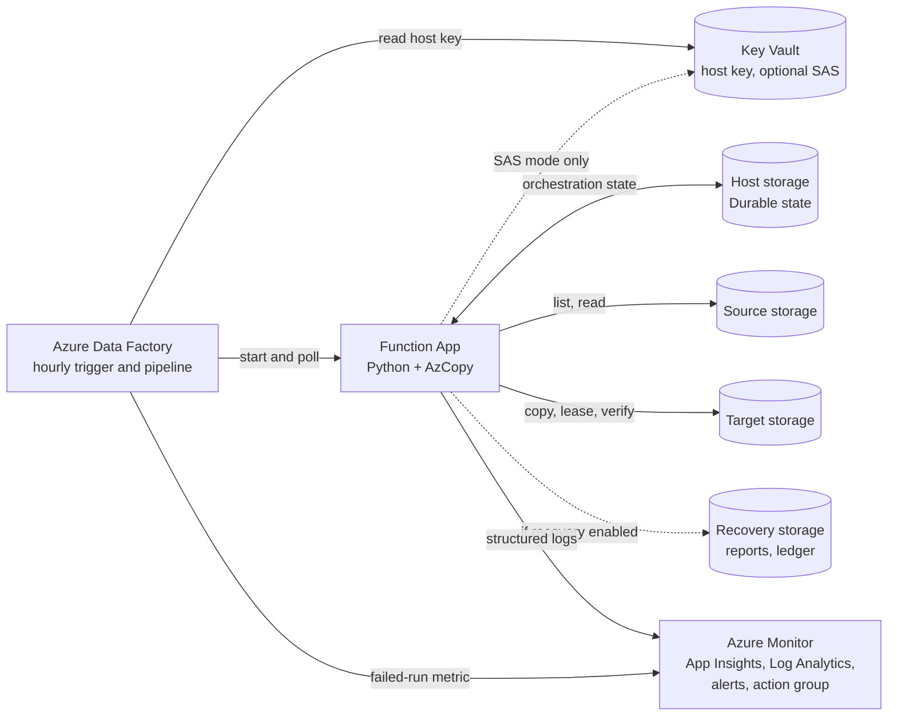

# Hourly Azure Blob copy with AzCopy — v4 summary

> **Purpose of this file:** A high-level overview for architects, operations teams and reviewers. For settings, deployment steps and runbooks, see the main [README](README.md). For a deployment without public endpoints, see the [Private Link deployment profile](infra/private-link/README.md).

---

## 1. What the function does

An Azure Data Factory (ADF) tumbling window trigger runs every hour. It calls an Azure Function that copies one UTC hour folder from a source Azure Blob Storage container to a target container using AzCopy v10.

```
Source:  <prefix>/YYYY/MM/DD/HH/...   (for example Level1/Level2/Level3/2026/11/18/14/...)
Target:  <prefix>/YYYY/MM/DD/HH/...   (same relative paths)
```

- The hour comes from the **start of the trigger window** in UTC (`00`–`23`), not the time the run starts. Backfills and manual reruns use the same rule.
- One code package serves many storage account pairs. Deploy the same container image to separate Function Apps and set the accounts, containers, prefixes and credentials as **app settings**. Callers cannot choose the storage accounts.

---

## 2. Capabilities

### Copy and scheduling
- **Hourly ADF trigger:** Runs once an hour with a configurable delay (default 10 minutes), one window at a time, and no end date unless you set one.
- **Long-running copies:** ADF starts the copy, then polls a status endpoint until it finishes. Durable Functions runs the transfer in the background, so it isn't limited by the 230-second HTTP response timeout.
- **Server-to-server copy:** AzCopy copies directly between storage accounts. By default it never overwrites existing target files and never deletes data.

### Authentication
- **Managed identity (default):** No keys or SAS tokens are stored. Python and AzCopy both use the Function App's managed identity.
- **Key Vault SAS (optional):** With `COPY_AUTH_MODE=key_vault_sas`, the Function reads the source and target SAS tokens from Key Vault at the start of each attempt.
- **Protected endpoints:** Both HTTP routes require a Function host key. ADF reads that key from Key Vault, so it is never stored in the pipeline definition.

### Reliability and data integrity
- **Destination-hour lease:** A renewable blob lease on the target hour stops two workers from writing to the same hour, even from different Function Apps or manual runs.
- **Smart retries:** Temporary errors (throttling, network, timeouts, a busy lease) are retried with backoff. Each retry takes a fresh inventory and copies **only the missing files**. Permission errors, data conflicts and unrecognized failures are not retried.
- **Strict manifest mode (optional):** The data producer publishes `_MANIFEST.json` last. The function checks file names, sizes and optional MD5 hashes, then writes a `_SUCCESS` marker only after verification. Downstream systems can wait for that marker.
- **Reconciliation:** A separate optional pipeline rescans recent hours and copies late arrivals. Files that conflict with existing target files are reported, never overwritten.

### Recovery
- **Failure reports:** When an hour finally fails, a private JSON report lists missing, conflicting and unverifiable files.
- **Recovery ledger:** An Azure Table tracks failed hours. An optional timer (every 15 minutes by default) retries hours that failed for temporary reasons, with growing delays, copying only missing files. It also works for hours older than the reconciliation window.
- **Operator path:** For permanent failures, an operator fixes the cause and starts a manual run with `mode=reconcile`.

### Private networking (optional profile)
- ADF reaches the Function App and Key Vault through a managed virtual network and managed private endpoints.
- Customer-VNet private endpoints cover the transfer storage, host storage, recovery storage, Key Vault, Container Registry and, optionally, Azure Monitor through an Azure Monitor Private Link Scope (AMPLS). The private DNS zones are included.
- Bicep templates, parameter examples and a staging checklist are included. They have **not** been compiled or deployed.

---

## 3. How the pieces connect



For the detailed version, showing each Python file and the service it calls, see [How the pieces connect](README.md#how-the-pieces-connect) in the README.

| Python file | Role |
|---|---|
| `function_app.py` | HTTP routes, Durable orchestrators and activities, and the recovery timer. |
| `copy_reliability.py` | One leased copy attempt: inventory, manifest checks, verification and the `_SUCCESS` marker. |
| `copy_job.py` | Settings, UTC window, the AzCopy command and structured logging. |
| `copy_recovery.py` | Failure reports, the recovery ledger and background recovery. |

---

## 4. Azure services to configure

| Service | Required? | What to set up |
|---|---|---|
| **Azure Data Factory** | Required | Import the linked services, pipeline and tumbling window trigger from `adf/`. Set the trigger `startTime` to the first UTC hour. Optionally add the reconciliation pipeline and trigger. |
| **Azure Functions** (Linux Premium, or Dedicated with Always On) | Required | Custom container with Python 3.12. Enable the managed identity and apply the app settings. |
| **Azure Container Registry** | Required | Stores the image. Add the official AzCopy v10 Linux binary at `bin/azcopy` before building. |
| **Source and target storage accounts** | Required | Create the containers. Give the copy identity **Storage Blob Data Reader** on the source and **Storage Blob Data Contributor** on the target. |
| **Host storage account** | Required | A separate account for the Functions host and Durable state (Blob, Queue and Table roles). |
| **Azure Key Vault** | Required | Holds the Function host key that ADF uses. It can also hold the source and target SAS tokens when SAS mode is used. |
| **Application Insights + Log Analytics** | Required | Workspace-based Application Insights, connected through the app setting. |
| **Recovery storage** (Blob container + Table) | Optional | Enables failure reports and the recovery ledger (`infra/recovery-storage.bicep`). |
| **Alert rules + action group** | Recommended | ADF failed-run alert, worker-failure log alert, and overdue-verification alert (`monitor/`). |
| **Private Link resources** | Optional | ADF managed virtual network, private endpoints, private DNS zones and AMPLS (`infra/private-link/`). |

---

## 5. Metrics and operational visibility

- **Structured logs:** Every event (started, finished, empty, verified, reconciled, conflicts, retry, failed, recovery) is written to Application Insights. Each line starts with `hourly_blob_copy ` and includes the ADF run ID, Durable instance ID, UTC window, file and byte counts, elapsed time, failure category and AzCopy job ID. Credentials and raw AzCopy output are never logged.
- **Ready-made queries (`monitor/`):**
  - `copy-windows.kql`: hour-by-hour status, volumes and durations.
  - `copy-failures.kql`: final worker failures, used by the optional early-warning alert.
  - `recovery-events.kql`: follows a failed hour through background recovery.
  - `verification-overdue.kql`: hours without a `_SUCCESS` verification by the deadline (strict mode).
- **Alerts:**
  - ADF `PipelineFailedRuns` metric alert (`adf-failed-runs.bicep`).
  - Worker-failure log alert.
  - Overdue-verification alert (`verification-overdue.bicep`). By default it fires 90 minutes after an hour closes, and it also catches a stopped trigger.
- **ADF Monitoring:** Each pipeline run shows the runtime status, the error code and, when present, the name of the recovery report.
- **Recovery evidence:** Failure reports in the recovery container and rows in the ledger table give operators a durable record of each failed hour.

> **Note:** Changing the `hourly_blob_copy ` log prefix breaks the queries and alerts.

---

## 6. Documentation and maintainability

- **README.md:** Numbered sections (1–6) with an **At a glance** navigation table, settings grouped into tables, callouts for key warnings, the architecture diagram, and **section 6, Validate before activation**, the staging checklist to complete before turning on the trigger.
- **Commented code:** Each Python file opens with an overview and is split into numbered sections. Each section explains its purpose and which other files or functions depend on it. The comments also point out things that are easy to break, such as the log prefix and the older orchestrator versions kept so runs already in progress can finish after an upgrade.
- **Tests:** 56 local unit tests cover the window logic, settings validation, retries, verification, recovery, the HTTP routes and the Private Link templates.
- **Private Link guide:** `infra/private-link/README.md` covers setup, DNS and the cutover warning. Adding the first private endpoint to a Function App can turn off public access if `publicNetworkAccess` isn't set explicitly.

---

## 7. Readiness

| Item | Status |
|---|---|
| Python code and local unit tests (56) | Done; all pass locally |
| ADF, monitoring and Private Link definitions | Written; Bicep **not compiled** |
| AzCopy binary | **Not included.** Download the official v10 Linux x64 release and place it at `bin/azcopy` |
| Live Azure testing | **Not done.** Run README section 6 and, for private deployments, the Private Link staging checklist |
| Azure resources | **None deployed or changed** by this package |
